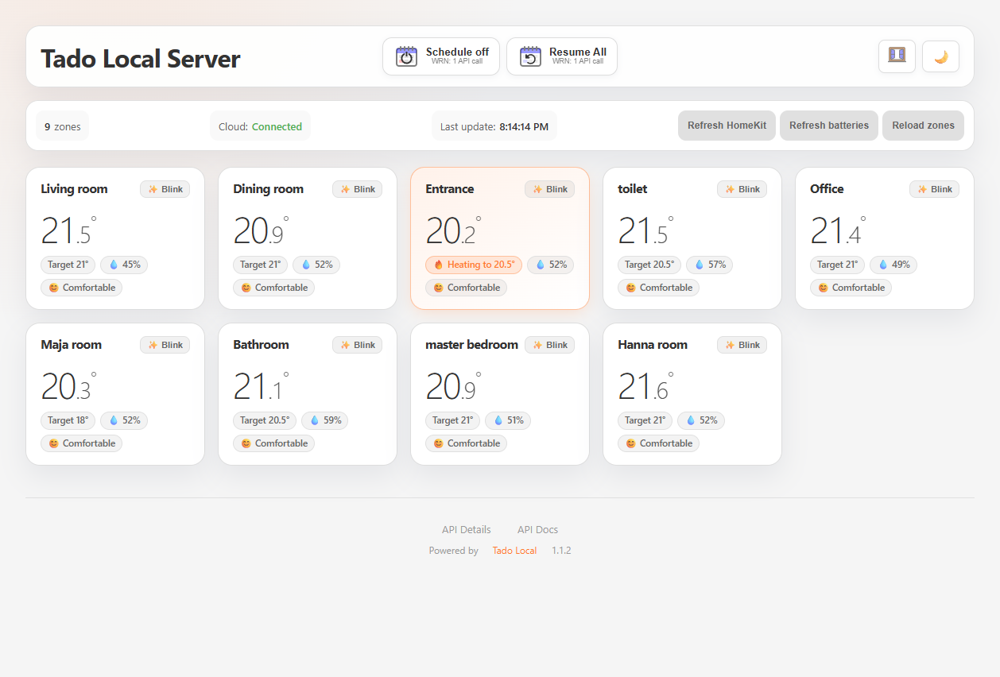
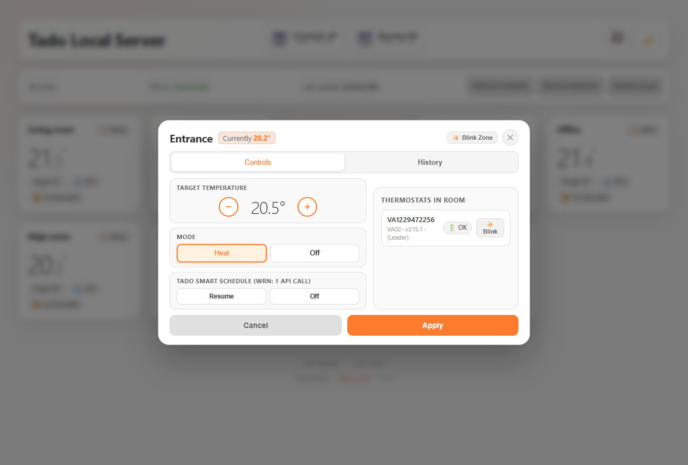
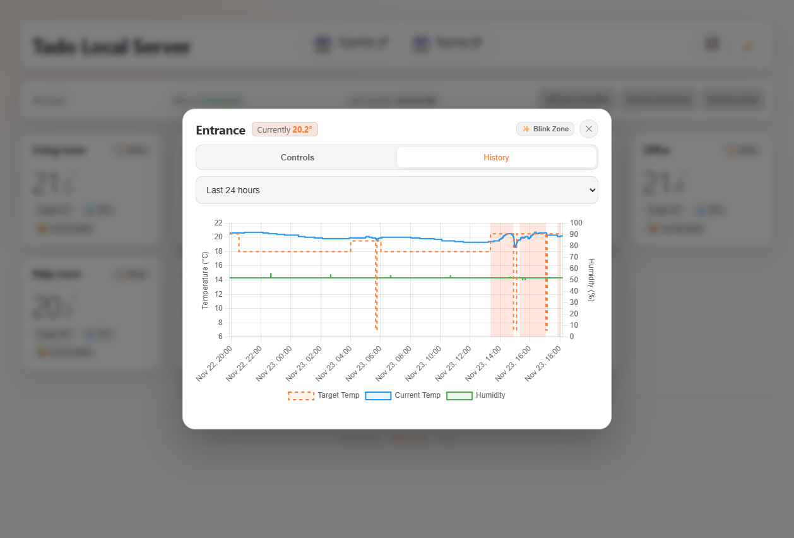

# Tado Local Server

[](LICENSE)
[](Dockerfile)
[](https://www.python.org/downloads/)
[](https://www.home-assistant.io/blog/2016/02/12/classifying-the-internet-of-things/)
[](https://github.com/ExcaliburDk/tado-local-homeassistant)

A high-performance local REST API bridge and responsive Web UI for **Tado smart heating and cooling systems**.

Communicates directly with your local Tado Internet Bridge over your LAN using the Apple HomeKit protocol (HAP) — **100% local, zero internet dependency for routine heating control, instant response times, and immune to cloud outages or API rate limits.**

---

## ☕ Credits & Attribution

This project is a modernized, extended fork of [AmpScm/TadoLocal](https://github.com/AmpScm/TadoLocal) by **Bert Huijben (@AmpScm)**. 

All foundational HomeKit reverse-engineering, local protocol communication, and initial architecture originate from AmpScm's initial project. We are deeply grateful to Bert Huijben and the contributors who paved the way for local Tado control.

### 🚀 Key Improvements & Features Added in this Version:
- 📅 **Local Schedule Engine & Cloud Overrule**: Create custom weekly heating schedules directly in the web UI without sending schedule data to Tado Cloud. Overrule Tado Cloud schedules per-zone with a single toggle, running 100% locally on your LAN.
- 📱 **Modern Streamlined Web UI**: A clean, compact 2-column modal interface that fits target temperature, presets, active heating state, battery badges, and device serials on a single screen (~360px) without scrolling.
- 💡 **Identify / Blink Display**: Physical visual verification of radiator thermostats (VAxxx) via LED blinking — available through REST endpoints (`/devices/{id}/identify`, `/zones/{id}/identify`) and UI "Blink" buttons.
- ⚡ **Zero-Block Startup**: Eliminates upstream container startup freezes when bridge IP is not pre-configured, allowing effortless web-based discovery and pairing.
- 🔥 **Live HVAC Valve Status**: Real-time reporting of physical heating valve activity (`heating`, `idle`, `off`) matching actual boiler/radiator demand.
- 🧹 **Automatic History Purge**: Automatically cleans SQLite database records older than 30 days (`--purgehistory`) to prevent database bloat.
- 🐳 **Docker Healthchecks & Port Mapping**: Native Docker `HEALTHCHECK` and full support for container bridge port remapping (`EXTERNAL_PORT`, e.g. port `4408` or `4407`).
- 🔄 **On-Demand Cloud & Battery Sync**: Dedicated `/refresh/cloud` endpoint to refresh battery status and API rate limits without waiting for periodic polling.
- 📦 **Cross-Platform Deployments**: Tested and pre-configured for Docker Compose, QNAP Container Station, Synology Container Manager, Raspberry Pi, and standard Linux.

---

## 📸 Web Interface Preview

| Main Dashboard Overview | Streamlined 2-Column Room Controls |
|:---:|:---:|
|  |  |

| Historical Temperature, Humidity & Heating Analytics |
|:---:|
|  |

---

## 🏠 Companion Home Assistant Integration

Looking for Home Assistant control? Use our custom HACS integration designed specifically to pair with this server:

👉 **[tado-local-homeassistant](https://github.com/ExcaliburDk/tado-local-homeassistant)**
- Real-time HVAC flame indicator (`hvac_action: heating / idle / off`)
- Physical display blink button entity for each radiator valve
- Automatic room naming: `Tado <Room> (<Serial>)`
- Automatic Home Assistant Area suggestions
- Battery low warning attributes & on-demand sync button

---

## 🐳 Quick Start & Deployment

### Option 1: Docker Compose (Recommended)

Save the following as `docker-compose.yml`:

```yaml
services:
  tado-local:
    image: ghcr.io/excaliburdk/tado-local-server:latest # or build locally
    build:
      context: .
      dockerfile: Dockerfile
    container_name: tado-local
    restart: unless-stopped
    ports:
      - "4407:4407"
    environment:
      - EXTERNAL_PORT=4407
      - PURGE_DAYS=30
      # Optional: specify IP if mDNS discovery is restricted across subnets
      # - TADO_BRIDGE_IP=192.168.1.100
      # - TADO_BRIDGE_PIN=123-45-678
    volumes:
      - tado-data:/data

volumes:
  tado-data:
    name: tado-local-data
```

Start the container:
```bash
docker compose up -d
```

---

### Option 2: QNAP NAS (Container Station / SSH)

We provide an automated, zero-downtime updater script specifically optimized for QNAP NAS:

1. Clone or download the repository to `/share/Container/tado-local`:
   ```bash
   cd /share/Container
   git clone https://github.com/ExcaliburDk/tado-local-server.git tado-local
   cd tado-local
   ```
2. Run the update / build script:
   ```bash
   sudo ./qnap-update.sh
   ```
3. The script automatically builds the container, binds port `4408` (or `4407`), maps persistent data to `tado-local-data`, and launches the service.
4. For detailed QNAP instructions, see [QNAP-UPDATE.md](QNAP-UPDATE.md).

---

### Option 3: Docker Run CLI

Run directly via the Docker command line:

```bash
docker run -d \
  --name tado-local \
  --restart unless-stopped \
  --user 0:0 \
  -p 4407:4407 \
  -e EXTERNAL_PORT=4407 \
  -e PURGE_DAYS=30 \
  -v tado-local-data:/data \
  excaliburdk/tado-local-server:latest
```

---

## ⚙️ Configuration (Environment Variables)

| Variable | Default | Description |
|---|---|---|
| `HOME_NAME` | `Tado Local Server` | Custom display name for your home in the Web UI (can also be changed directly by clicking the title in the browser). |
| `EXTERNAL_PORT` | `4407` | Host port mapped to the container (used for accurate mDNS zeroconf advertisement). |
| `PURGE_DAYS` | `30` | Auto-purges history data older than this number of days from the SQLite database. |
| `TADO_BRIDGE_IP` | *auto* | IP address of your Tado Internet Bridge (optional; mDNS discovers it automatically). |
| `TADO_BRIDGE_PIN` | *none* | 8-digit HomeKit pairing PIN from the sticker on your Tado bridge (`XXX-XX-XXX`). |
| `TADO_PORT` | `4407` | Internal listening port. |

---

## 📡 REST API Reference

When the server is running, explore interactive Swagger/OpenAPI documentation directly at:
👉 **`http://<SERVER-IP>:4407/docs`**

### Frequently Used Endpoints:

| Method | Endpoint | Description |
|---|---|---|
| `GET` | `/api` or `/health` | Healthcheck and server status |
| `GET` | `/zones` | Lists all heating/cooling zones with current temperatures and states |
| `GET` | `/zones/{zone_id}` | Detailed status for a specific zone |
| `POST` | `/zones/{zone_id}/set_temperature` | Sets target temperature (`{"temperature": 21.5}`) |
| `POST` | `/zones/{zone_id}/identify` | Blinks LED display on all radiator valves in the zone |
| `POST` | `/devices/{device_id}/identify` | Blinks LED display on a specific device |
| `POST` | `/refresh/cloud` | Triggers immediate on-demand cloud sync for battery levels and quota |
| `GET` | `/events` | Server-Sent Events (SSE) live push stream for real-time state changes |

---

## 📜 License

This project is licensed under the **GNU General Public License v3.0 (GPL-3.0)**. See [LICENSE](LICENSE) for details.
